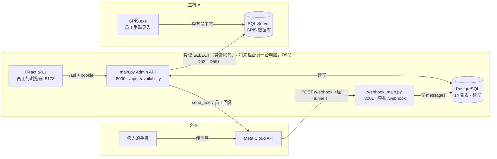
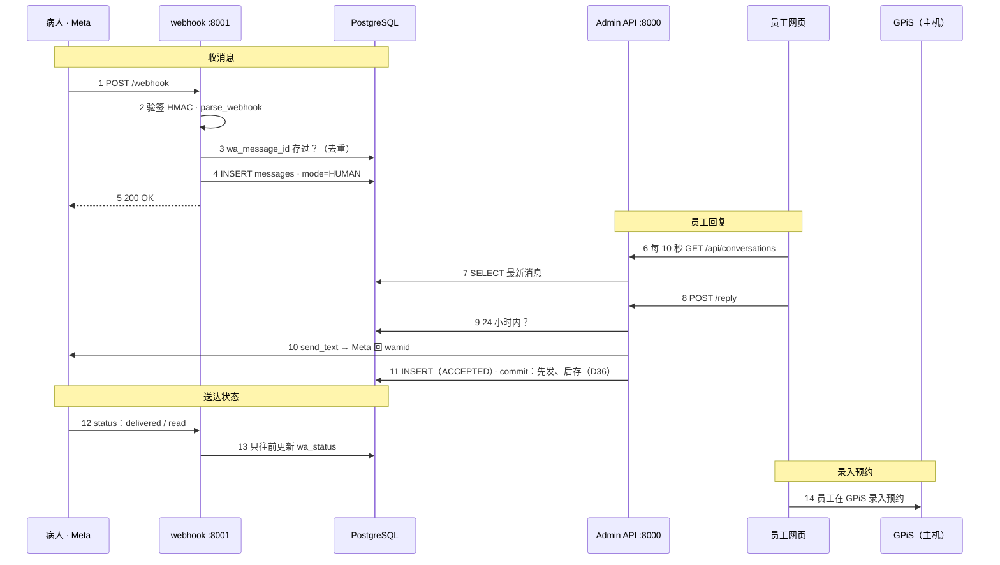
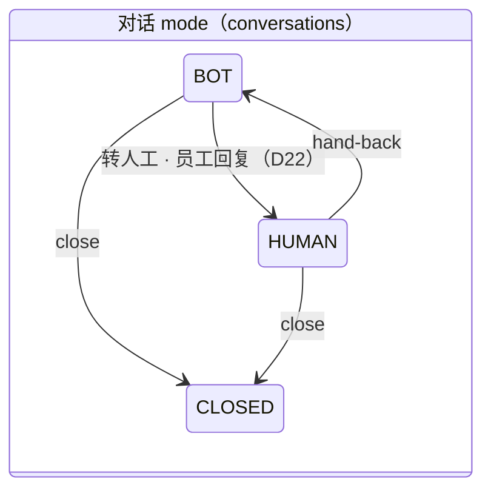
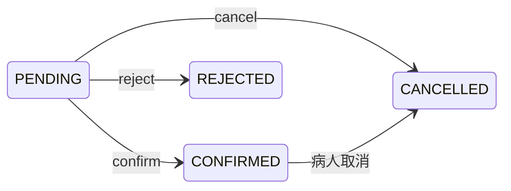
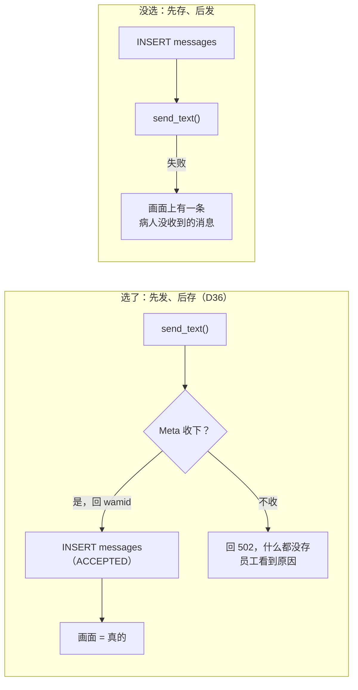
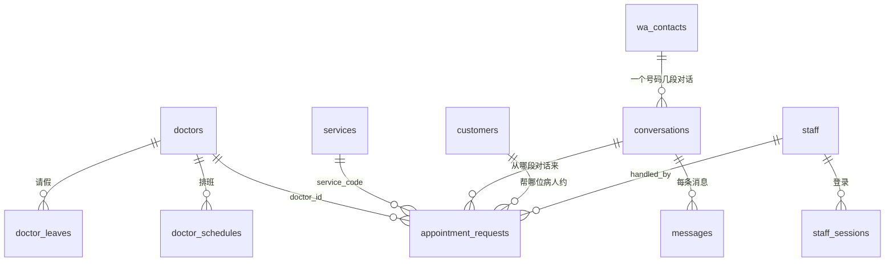

# 代码导读（学习笔记）

> 2026-10-11，按 `main` @ `d3c15ea`（PR #15 合并后）整理。行号以这个版本为准，之后改了代码可能会偏几行。
> 图用 Mermaid 画，在 GitHub 上会显示成图。图片版（同样内容）在 claude.ai 上的「Chatbot_Automation 代码地图」，不在仓库。
> 表格和例子里的预约、电话都是假资料。

按六个问题读代码：

| 阶段 | 要搞清楚什么 |
|---|---|
| ① 系统地图 | 项目有哪些模块，每个模块负责什么？ |
| ② 数据流 | 一次预约从用户操作到数据库保存，经过哪些步骤？ |
| ③ 架构选择 | 为什么选择这些技术，而不是其他方案？ |
| ④ 数据库 | 每张表的用途、表与表之间的关系、JOIN 为什么这样写？ |
| ⑤ 关键代码 | 找出真正重要的函数，理解输入、处理逻辑和输出 |
| ⑥ 测试与部署 | 出现错误时怎样定位？系统部署后怎样运行？ |

---

## ① 系统地图



**两条边界最重要：**外网只连得到 8001 的 `/webhook`，Admin API 和读 GPiS 的 `/availability` 不对外（D35）。GPiS 只被 `SELECT`，把预约写进 GPiS 的永远是员工（D5、D6）。

| 层 | 文件 | 负责什么 |
|---|---|---|
| **读 GPiS** | `gpis.py` | 只执行 SELECT；连接后先核对数据库名字；读主机的 `GPiS` 时还检查帐号是不是只读的，不是就拒绝（D59）；每次重新读，不缓存 |
| **业务规则（纯计算，不连数据库）** | `availability.py` | 某天某医生哪些时段能约（Phase 1 SQL 的 Python 版） |
| | `reminders.py` | 提醒名单：Ready / Needs staff / 不是预约，家人合成一条，生成消息 |
| | `phone.py` | 各种写法的电话统一成 `60123456789` |
| | `clinic_rules.py` | 诊所设置在程序里的形状（dataclass） |
| **本系统数据库** | `db/models.py` | 14 张表，表结构以它为准 |
| | `db/conversations.py`、`db/appointment_requests.py`、`db/reminders.py` | 对表的操作；只 `flush`，由调用方决定什么时候 `commit` |
| | `db/rules.py` | 设置表 → `ClinicRules` |
| | `migrations/` | Alembic 版本 |
| **WhatsApp** | `whatsapp.py` | 验签、解析 webhook、`send_text`（只发给允许名单里的号码） |
| | `webhook.py` + `webhook_main.py` | 对外的小程序 |
| **API 与登录** | `main.py` + `api/*.py` | 6 组 router：auth、conversations、requests、reminders、settings、staff |
| | `auth.py` | session cookie、`current_staff`、`require_admin` |
| **网页** | `frontend/src/` | `api.ts` 是唯一调用后端的地方；`pages/` 每页一个文件；`types.ts` 和后端回传格式对应 |
| **工具** | `reminders_cli.py`、`whatsapp_check.py`、`cli.py` | 终端检查工具，输出没有病人资料 |

**设计重点：**业务规则写成纯函数，输入普通资料、输出结果，不连数据库。所以能完全用假资料测试，资料来源（`GPiS_Dev`、假资料、将来的主机）也能换，不用改规则。

---

## ② 数据流

先知道两件事：**系统不写入 GPiS**（D5），**AI 也还没做**（Phase 6）。现在能跑的是"病人传消息、员工回复"；真正把预约存起来的，是员工在 GPiS 里手动录入。

### A. 病人传消息 → 员工回复（已经能跑）



- **第 3 步**防止 Meta 重送同一条消息时存两次。
- **第 4 步**还没有 AI，新对话直接交给员工（D37）。
- **第 10、11 步**的顺序是刻意的：Meta 收下了才存，画面上的"已发出"一定真的发出去了。
- **第 13 步**状态只往前走，因为 read 可能比 delivered 先到。

### B. AI 预约（设计好、还没接上，Phase 6）

```
病人 → AI 调 /availability（availability.py 读 GPiS 算空档）
     → 建 appointment_requests（PENDING）
     → 员工在 Requests 页面看 → 在 GPiS 录入 → 按 Confirm（CONFIRMED）
```

`create_appointment_request()` 已经写好，但**现在没有 API 调用它**，只有 `db/demo.py` 用它造假资料。

### 两个状态机



病人在 `CLOSED` 之后再传消息，会开一段新的对话。



允许的改法写在 `_ALLOWED`（`db/appointment_requests.py:21`），其他改法 API 回 409。

### C. 提醒（5b）

| 步骤 | 做什么 | 为什么 |
|---|---|---|
| `GET /api/reminders` | 读 GPiS → `build_reminder_list()` → 网页 | 名单不存，每次重算（GPiS 随时会改） |
| 员工按 *Open in WhatsApp* | `POST /opened`：后端重新读 GPiS、重新算那一天 | 不信任画面送来的消息 |
| 记下来 | `INSERT … ON CONFLICT DO UPDATE` 进 `reminders` | 两位员工同时按也只有一条（D58） |

---

## ③ 架构选择

每个选择都记在 [`decisions.md`](decisions.md)，格式是"决定 + 原因"。读的时候先问：**不这样做，会出什么问题？**

一个例子：员工回复病人时，"先发后存"和"先存后发"只是两步的顺序不同，出错时员工看到的完全不一样。



| 选了 | 没选 | 原因 | 决定 |
|---|---|---|---|
| GPiS 只读，员工手动录入 | 系统直接写进 GPiS | `AppointmentID` 不是自动编号，同时写会冲突 | D5、D6 |
| 两个数据库：SQL Server 只读 + PostgreSQL 读写 | 在 GPiS 里加表 | 不碰厂商的数据库，职责分开 | D9 |
| 读主机用专门的只读帐号，每次连线检查权限 | 用 GPiS 自己的 `sa` | 最小权限；就算连线字符串被改成 `sa`，系统也拒绝读 | D7、D52、D59 |
| 设置存在数据库 | 写死在程序里 | 排班、假期每年会变，员工要能自己改 | D14 |
| FastAPI + SQLAlchemy 2.0 + Alembic | 直接写 SQL、不留版本 | 表结构有版本；测试核对 migration 和 models 一样 | D18 |
| 规则写成数据库约束 | 只在 Python 检查 | 程序有 bug、请求同时到时，数据库是最后一道防线 | D19 |
| 测试连真的 PostgreSQL | SQLite | partial index、CHECK、时区的行为不同 | D20 |
| 服务器端 session + HttpOnly cookie | JWT | 员工停用马上失效；JavaScript 偷不到 token | D26 |
| 网页和 API 同一个网址 | 开 CORS | `SameSite=Strict` 的 cookie 只在同一个网址带上 | D29 |
| 只用 React + React Router | UI 套件、Redux | 画面不多；套件越少，供应链风险越小 | D30 |
| 每 10–30 秒重新读取 | WebSocket | 员工少，这样最简单 | D32 |
| webhook 单独一个程序 | 放进 main.py | 外网只看得到 `/webhook` | D35 |
| 对话按号码分 | 按病人分 | 2,243 个号码有多于一位病人（家人共用） | D17 |
| 不确定就交给员工 | 尽量自动 | Remarks 是自由文字；推荐错比少推荐伤害大 | D15、D41 |

**思考题：**为什么"诊所设置"（D14）存进数据库，"提醒名单"（D58）却不存、每次从 GPiS 重新算？答案在资料真正的来源在哪里：设置的来源是本系统，名单的来源是 GPiS。存一份副本，就会出现两边不一致。

---

## ④ 数据库

### 14 张表（`db/models.py`）



图里没画的：`clinic_closures`、`clinic_settings` 没有外键；`staff` 还被 `messages`、`conversations`、`reminders`、`wa_contacts` 引用（"谁做的"）；`reminders` 和 `wa_contacts` 按 `wa_phone` 的值对应，**没有外键**。

| 表 | 用途 | 值得注意的约束 |
|---|---|---|
| `doctors` | 医生，ID = GPiS 的 `DoctorID` | `id = upper(btrim(id))`；离职改 `active=false`，不删除 |
| `doctor_schedules` | 星期几几点上班、午休 | 主键 (doctor_id, weekday)；时间一定在 :00 / :30（`_on_grid`） |
| `services` | 疗程代码 | `treatment_group` 用来找"上一次同类疗程的医生" |
| `clinic_closures`、`doctor_leaves` | 假期、请假 | 主键含日期，同一天不会重复 |
| `clinic_settings` | 每格上限等 | `CHECK id = 1`：只有一行，每个设置一栏，才能有类型检查 |
| `staff`、`staff_sessions` | 员工、登录 | 只存 token 的 SHA-256 |
| `wa_contacts` | 一个 WhatsApp 号码 | `wa_phone` UNIQUE；opt-out 的三栏要一起有或一起没有 |
| `conversations` | 一段对话 | **partial unique index**：`mode <> 'CLOSED'` 时每个号码只能有一段 |
| `messages` | 每条消息 | `wa_message_id` UNIQUE（去重）；`wa_status` 只有发出的消息才有 |
| `customers` | 病人 | `phone` **不唯一**（家人共用号码） |
| `appointment_requests` | 预约请求 | `(status='PENDING') = (handled_at IS NULL)` |
| `reminders` | 员工按过 Open in WhatsApp | UNIQUE (日期, 号码)：两位员工同时按也只有一条 |

**最值得学的约束：**`conversations` 上的 partial unique index（`models.py:297`）。它让"一个号码同时只有一段没结束的对话"由数据库保证。两条消息同时到时，第二个 INSERT 违反 unique，`_insert_or_get()` 接住错误，改成读第一个请求建好的那一行。这是处理并发的标准做法。

### JOIN 为什么这样写

**1. 提醒怎么拿到电话：LEFT JOIN 视图（`gpis.py:28`）**

```sql
SELECT a.AppointmentID, a.AppointmentDate, a.TimeSlot, a.DoctorID, a.Status,
       a.ContactID, a.ContactName, a.Remarks, q.HPNo
FROM dbo.Tbl_CAH_Appointment a
LEFT JOIN dbo.Qry_CAH_Appointment q ON q.AppointmentID = a.AppointmentID
WHERE a.AppointmentDate >= ? AND a.AppointmentDate < ?
```

假资料的例子：

| `a`：AppointmentID | TimeSlot | | `q`：AppointmentID | HPNo |
|---|---|---|---|---|
| 1001 | 10:00 | | 1001 | 012-000 0001 |
| 1002 | 10:30 | | 1001 | （空） |
| 1003 | 11:00 | | 1003 | 016-000 0003 |

| 结果：ID | 时间 | 电话 | 之后 |
|---|---|---|---|
| 1001 | 10:00 | 012-000 0001 | 留下 |
| ~~1001~~ | ~~10:00~~ | ~~（空）~~ | Python 去掉重复 |
| 1002 | 10:30 | NULL | *Needs staff*：No mobile number |
| 1003 | 11:00 | 016-000 0003 | 留下 |

- **为什么用 LEFT，不用 INNER：**1002 没有电话，INNER JOIN 会让它直接消失，员工就不知道漏了谁。LEFT JOIN 留下它，放进 *Needs staff*。
- **为什么 JOIN 视图、不 JOIN `Tbl_CAH_Contact`：**视图里已经有 `HPNo`（统计 B10、B11 验证过）。只拿需要的栏位，不读 NRIC、地址（D44）；只读帐号也只给了这两个对象（D59）。
- **视图里同一个预约可能有好几行：**Python 只留第一个有号码的（`gpis.py:171`）。
- **日期为什么写 `>= 当天 AND < 隔天`：**`AppointmentDate` 是 datetime。写成 `CAST(... AS date) = ?` 每行都要先转换，用不到索引。

**2. 其他查询**

| 查询 | 写法 | 为什么 |
|---|---|---|
| 对话列表：每段对话的最新消息（`api/conversations.py:97`） | 子查询 `max(id) GROUP BY conversation_id` → OUTER JOIN 两次 | "每组取最新一笔"的标准写法；OUTER 让还没有消息的对话也显示，所以排序用 `coalesce` |
| 24 小时规则（`db/conversations.py:202`） | `messages JOIN conversations`，取病人最后一条的 `max(created_at)` | 窗口用算的，不另存一栏，不会和消息记录对不上（D23） |
| 读排班（`db/rules.py:23`） | `doctor_schedules JOIN doctors WHERE active` | 离职医生的排班自动排除 |
| 记下按过的提醒（`db/reminders.py:46`） | `INSERT … ON CONFLICT DO UPDATE` | upsert：两位员工同时按也安全 |
| 查好几个提醒（`db/reminders.py:34`） | `tuple_(date, phone).in_(keys)` | 用复合键一次查多笔 |

---

## ⑤ 关键代码

### `check_available_slots` 怎么判断一天能不能约

由上往下检查，碰到第一个符合的就停（`availability.py:162`）。SQL 版本的顺序完全一样（`sql/check_available_slots.sql` 第 5 节）。

| 顺序 | 检查 | `day_status` |
|---|---|---|
| 1 | 排班表里没有这位医生 | `UNKNOWN_DOCTOR` |
| 2 | 那天在 `clinic_closures` | `CLINIC_CLOSED` |
| 3 | 医生那天固定休息 | `DOCTOR_NOT_WORKING` |
| 4 | 那天在 `doctor_leaves` | `DOCTOR_ON_LEAVE` |
| 5 | GPiS 的 Remarks 有 OFF DAY | `OFFDAY_IN_GPIS` |
| 6 | 有诊所联系人的占位记录 | `NEEDS_REVIEW` |
| 7 | 有看不懂的时长写法 | `NEEDS_REVIEW` |
| 8 | 以上都没有 | `OK` |

1–5 整天不能约；`NEEDS_REVIEW` 照样算空档，但 AI 不自动推荐，交给员工。

### 每一格的上限（例子：PHANG，疗程 `S+P`，能当第 3 人；假资料）

| 时段 | 已约 | 说明 | 上限 | 30 分钟 | 1 小时 |
|---|---|---|---|---|---|
| 09:00 | 1 | 下一格满 3 | 2 | ✓ | ✗ |
| 09:30 | 3 | | 3 | ✗ | ✗ |
| 10:00 | 2 | 上一格满 3 | 2 | ✗ | ✗ |
| 10:30 | 0 | | 3 | ✓ | ✗（11:00 有人） |
| 11:00 | 1 | 1 hour 预约（LONG APPT） | — | ✗ | ✗ |
| 11:30 | 0 | 被 11:00 的 1 hour 占住 | — | ✗ | ✗ |
| 12:00 | — | BREAK | — | ✗ | ✗ |
| 12:30 | — | BREAK | — | ✗ | ✗ |
| 13:00 | 0 | | 3 | ✓ | ✓ |
| 13:30 | 0 | | 3 | ✓ | ✓ |

- **上限规则：**能当第 3 人的疗程，而且前后两格都没满 3 人，上限才是 3，否则是 2（W2、W15）。再和 `max_per_slot`、`max_per_slot_for_ai` 取最小。
- **1 小时：**这一格和下一格都要 0 人、没被长预约占住、下一格不是午休。

### 函数卡片：输入 → 处理 → 输出

**规则（纯函数）**

| 函数 | 输入 | 处理 | 输出 |
|---|---|---|---|
| `check_available_slots`（`availability.py:141`） | 日期、医生、疗程、GPiS 当天预约、`ClinicRules` | 排除取消的 → 判断当天状态 → 建 30 分钟格子 → 每格算人数、长预约、上限 | `DayAvailability`：当天状态 + 每格 `can_30`、`can_60` |
| `parse_appointment`（`availability.py:116`） | 一条 GPiS 预约 | Remarks 转大写去空格，读出时长（`1HOUR` → 2 格）、OFF DAY、诊所占位 | `ParsedAppointment`；`.occupies` = 这条算不算病人，提醒也用它（D41） |
| `build_reminder_list`（`reminders.py:243`） | 日期、预约、设置、医生名字、opt-out 号码 | 分出不是预约的 → 每条找问题 → 按 (日期, 标准化号码) 分组 → 一位家人有问题，整个号码交给员工 | `ReminderList`：ready、needs_staff、not_appointments |
| `lab_work_not_arrived`（`reminders.py:88`） | Remarks 原文 | 有戴牙代码、前面不是 `AFTER`、后面没有 `*C` | `True` = 技工所的东西还没到（D50、D57） |
| `reminder_dates`（`reminders.py`） | 今天、假期 | 从明天往后找，一直到第一个营业日 | 平常 [明天]，假期前 [明天, 后天] |
| `normalize_phone`（`phone.py:14`） | `012-345 6789`、`+65 9123 4567` … | 去掉非数字；0 开头补 60；8 位、8 或 9 开头补 65 | `60123456789`，看不懂就 `None` |

**数据库、WhatsApp、登录**

| 函数 | 输入 | 处理 | 输出 |
|---|---|---|---|
| `record_incoming_message`（`db/conversations.py:84`） | 号码、内容、wamid | wamid 存过就停 → 找或建号码 → 找或开对话 → 存消息 | (消息, 是不是新的)；不是新的就不再叫 AI |
| `_insert_or_get`（`db/conversations.py:37`） | 新物件、查同一笔的 SELECT | 在 savepoint 里 INSERT；违反 UNIQUE 就改读别人先建的那一行 | 一定拿到一行，同时到的请求也一样 |
| `update_message_status`（`db/conversations.py:149`） | wamid、Meta 送来的状态 | 按 ACCEPTED < SENT < DELIVERED < READ 只往前；FAILED 之后不再改 | 更新后的消息；不是本系统发的就不管 |
| `valid_signature`（`whatsapp.py:44`） | App Secret、原始 body、`X-Hub-Signature-256` | HMAC-SHA256，用 `compare_digest` 比较（防时序攻击） | 是不是 Meta 送来的；不是就回 401 |
| `current_staff`（`auth.py:86`） | 请求里的 session cookie | token 做 SHA-256 → 查 session、检查过期、员工是否 active | `Staff`，或 401 |
| `GpisReader._query`（`gpis.py:132`） | SQL、参数 | 只读连线 → 核对数据库名字 → 读主机 `GPiS` 时用 `permission_problems()` 检查帐号（D59） | 资料；名字不对或帐号能写就 raise，API 回 503 |

**建议的阅读顺序：**`phone.py`（30 行，暖身）→ `availability.py` 对照 `sql/check_available_slots.sql`（同一套逻辑，一份 SQL、一份 Python）→ `reminders.py` → `db/conversations.py` → `webhook.py` → `api/conversations.py` 的 `reply`。

---

## ⑥ 测试与部署

### 出错时先看状态码

后端每种错误都有固定的状态码，看状态码就能缩小范围：

| 状态码 | 意思 | 去哪里看 |
|---|---|---|
| 401 | 没登录、session 过期 | `auth.current_staff` |
| 403 | STAFF 做了 ADMIN 才能做的事 | `auth.require_admin` |
| 409 | 状态不允许（对话已结束、请求已处理）、超过 24 小时、数据库 UNIQUE（附 `rule` 名字） | 对应的 `_change` / `_act`；`main.py:31` |
| 422 | 输入格式错；数据库 CHECK（附 `rule` 名字，例 `..._on_grid`） | 到 `models.py` 找同名约束 |
| 502 | WhatsApp 不接受 | 画面上的 Meta 错误代码 |
| 503 | GPiS 读不到、数据库名字不对、帐号不是只读的、设置还没 seed、WhatsApp 没设定 | uvicorn 视窗的日志 |
| 网页显示 *Is the backend running?* | 后端没开 | `frontend/src/api.ts` 的 `errorMessage()` |

**然后：**

1. 看 uvicorn 日志：只有数量和 ID，没有病人资料，可以贴出来问人。
2. 用检查工具：WhatsApp 用 `python -m app.whatsapp_check`；GPiS 栏位和帐号权限用 `python -m app.reminders_cli --check-gpis`。
3. 查 [`backend/README.md`](../backend/README.md) 的常见问题表（例：webhook 回 401 = App Secret 填错，503 = `.env` 没读到）。
4. 写一个会失败的测试重现问题，再修。D57（`C/UP AFTER ISSUE DENTURE` 被误判）就是这样修的。

### 测试的层次

| 层 | 例子 | 怎么做到不碰真资料 |
|---|---|---|
| 纯函数 | `test_availability.py`、`test_reminders.py`、`test_phone.py`、`test_gpis_readonly.py` | 直接 new 出假的预约、假的权限结果，不需要数据库 |
| 数据库 | `test_db_*.py` | `conftest.py`：数据库名字要以 `_test` 结尾；每个测试一个交易，结束就 rollback；`DATABASE_URL` 被禁止连接 |
| API | `test_admin_*.py`、`test_whatsapp.py` | `TestClient` + `dependency_overrides`；WhatsApp 用假的 httpx transport |
| migration | `test_db_migrations.py` | migration 建出来的表和 `models.py` 一样 |
| 网页 | `frontend/src/*.test.tsx` | Vitest + `test/fakeApi.ts` 假后端 |
| 对照 | `backend/README.md` 的对照记录 | 10 个测试日期，SQL 和 Python 的结果要一样 |

### 部署后怎样运行

**现在：开发电脑，4 个视窗**

```powershell
uvicorn app.main:app --reload                       # 1. Admin API（8000）
uvicorn app.webhook_main:app --reload --port 8001   # 2. webhook
cloudflared tunnel --url http://localhost:8001      # 3. 只把 8001 放上网
npm run dev                                         # 4. 网页（5173，/api 转给 8000）
```

改表结构：`models.py` → 新 migration → `alembic upgrade head` → `pytest`（步骤见 `backend/README.md`「改表结构的步骤」）。

**计划：柜台另一台电脑（D53）**，同一套程序搬过去，经局域网只读读主机 A。还没做的：

- 主机 A 的只读帐号：脚本已经写好（`sql/create_readonly_login.sql`，D59），先在开发电脑测试，装到柜台电脑时才在 A 上建
- 开机自动启动
- PostgreSQL 每天加密备份
- 局域网也用 https（D26）
- webhook 改用 named tunnel（固定网址）
- `npm run build` 后由同一个服务器提供网页和 `/api`（D29）

---

## 练习（每个阶段一个，在开发电脑上用假资料做）

1. **系统地图：**不看这份笔记，凭记忆画出系统地图，再和 `main.py:27` 的 router 清单对照。
2. **数据流：**读 `tests/test_whatsapp.py` 里一个 webhook 测试，逐行对照时序图的步骤 1–5。
3. **架构选择：**任选 `decisions.md` 的一条，说出"不这样做会出什么问题"。
4. **数据库：**在 `chatbot_dev` 手动 INSERT 两段同一个号码、`mode='BOT'` 的对话，看 partial unique index 怎么挡下第二段。
5. **关键代码：**选一个测试日期，`check_available_slots` 和 SQL 各跑一次，逐格对照 `can_30`。
6. **测试与部署：**把 `doctor_schedules` 的 `start_time` 改成 `09:15`，看 API 回什么状态码、`rule` 是哪一条约束。
